# PROGRES - Mini-Projet 1

- Iliann Vaillant : **21315004**
- Belkerdid Islam : **21618834**


Ce dossier contient un relais TCP (exercice 1), un relais HTTP avec cache, journal et censure (exercice 2) et un programme d'audit.

| Fichier | Rôle |
|---|---|
| `relay.py` | Exercice 1 : relais TCP |
| `http_relay.py` | Exercice 2 : relais HTTP (cache, journal, censure) |
| `http_utils.py` | Exercice 2 : fonctions partagées (lecture et construction des messages HTTP, cache, journal, censure) |
| `audit.py` | Exercice 2 : programme d'audit du journal |
| `banned.txt` | exemple de fichier de sites interdits (`google.com`) |

Pour tous les tests, on lance d'abord le serveur, puis le relais, puis le client.

---

## Exercice 1 - Relais TCP

### Principe

Un relais se comporte comme un serveur pour le client et comme un client pour le serveur. Il n'a pas d'adresse IP à lui : il utilise celle de la machine où il tourne. Le client se connecte à cette adresse et au port d'écoute du relais, et le relais se connecte au vrai serveur avec l'adresse et le port donnés en ligne de commande.

```
client  --->  relais (écoute sur relayPort)  --->  serveur (serverAddress:serverPort)
        <---                                 <---
```

Il y a donc deux connexions TCP distinctes : client-relais et relais-serveur.

Fonctionnement :

1. Le relais écoute (`bind`, `listen`, `accept`) et lance un thread par client accepté.
2. Ce thread ouvre sa propre connexion vers le vrai serveur avec `connect`.
3. Il lance un deuxième thread qui copie les données serveur → client, et il fait lui-même la copie client → serveur. Chaque copie est la même fonction, `forward(src, dest)` : elle fait `recv` puis `sendall` en boucle, sans rien décoder.
4. Quand un côté a fini d'envoyer (`recv` renvoie `b''`), `forward` fait `shutdown(SHUT_WR)` sur l'autre socket pour le prévenir, sans couper l'autre sens.
5. Le thread attend la fin du deuxième avec `join`, puis ferme les deux sockets.

### Pourquoi deux sens en même temps

Le relais ne connaît pas le protocole utilisé. Il ne peut pas supposer que le client parle une fois puis que le serveur répond une fois. Le serveur peut parler le premier, répondre en plusieurs morceaux, ou le client peut envoyer plusieurs requêtes sur la même connexion (notre serveur de l'heure du TME1 fait ça). Un seul thread qui fait "recv client, send serveur, recv serveur, send client" reste bloqué sur un `recv` pendant que l'autre côté a des données en attente. Nous avons comparé avec une version qui fonctionne comme ça : elle marche pour le serveur de l'heure, mais elle bloque ou tronque avec une réponse de plus de 2048 octets. Avec deux boucles indépendantes, chaque sens est transmis dès que les données arrivent.

L'ordre des données n'est pas un problème : TCP garantit l'ordre sur chaque connexion, et chaque sens n'a qu'une boucle qui lit et une qui écrit.

Erreurs gérées : serveur éteint (`ConnectionRefusedError`), adresse invalide (`gaierror`), connexion coupée (`OSError` dans `forward`). Un timeout d'une seconde sur `accept` permet d'arrêter le relais avec Ctrl+C sous Windows.

### Comment lancer

```
python relay.py --relayPort 3456 --serverAddress 127.0.0.1 --serverPort 2345
```

| Option | Défaut | Rôle |
|---|---|---|
| `--relayPort` | 3456 | port d'écoute du relais |
| `--serverAddress` | 127.0.0.1 | adresse du vrai serveur (doit être joignable depuis la machine du relais) |
| `--serverPort` | 2345 | port du vrai serveur |

Test avec les programmes du TME1 (serveur de l'heure) :

```
python server.py --serverPort 2345
python relay.py --relayPort 3456 --serverPort 2345
python client.py --serverPort 3456 --count 4
```

Le client est configuré sur le port du relais, et le décalage d'horloge calculé reste proche de 0. On a testé :

- sur la même machine ;
- sur plusieurs machines (le client utilise l'IP de la machine du relais, le port du relais doit être ouvert dans le pare-feu) ;
- avec plusieurs clients en même temps.

Un fichier `multiple-client.sh` a aussi été utilisé pour faire les clients multiples.

```
./multiple-client.sh
```


### Tests réalisés

Pour tester notre relais TCP, nous avons d’abord effectué des essais sur une même machine, avec un seul puis plusieurs clients simultanés. Nous avons ensuite déployé le serveur sur une machine virtuelle afin de tester le fonctionnement du relais dans un environnement réparti sur deux machines. Pour réaliser ces tests, nous avons réutilisé le client et le serveur TCP développés lors du premier TME.

**Capture 1 : Client unique, même machine.** Comme nous pouvons le constater, le relais a bien transmis les informations dans les deux sens, et le client a pu calculer la moyenne des décalages d’horloge.

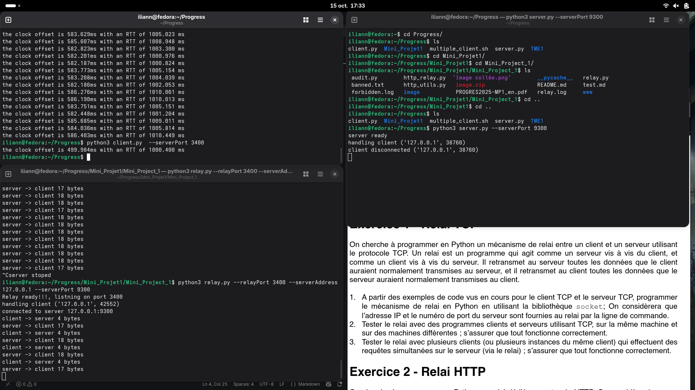


**Capture 2 : Client multiple, même machine.** Pour lancer plusieurs clients simultanément, nous exécutons le script `multiple-client.sh`, qui lance plusieurs instances du client. Nous observons que les requêtes d'horloge sont envoyées en parallèle, que toutes les réponses sont reçues correctement et que chaque client se déconnecte à la fin de son exécution.

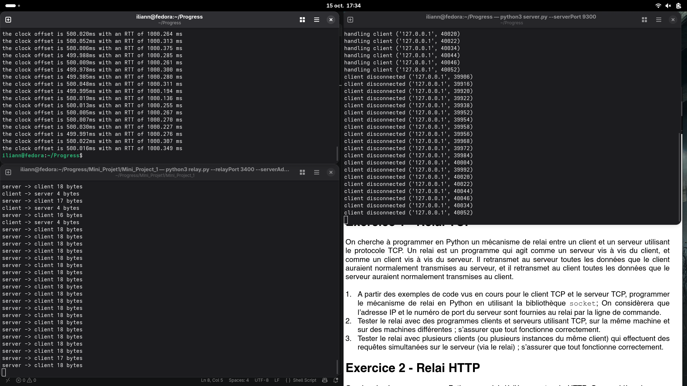

**Capture 3 : Client unique, machines différentes.** Le serveur se trouve désormais sur une machine virtuelle (VM). Le relais doit donc se connecter à l’adresse IP de la VM plutôt qu’à `localhost`. Comme nous pouvons le constater, la communication s’effectue correctement.

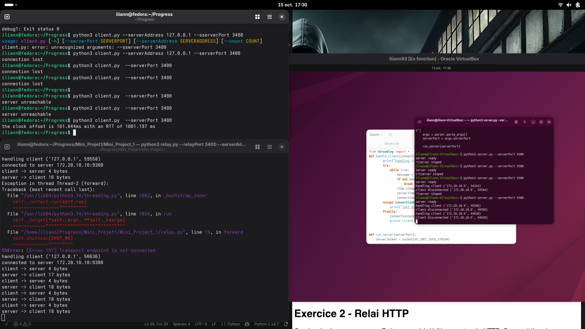

**Capture 4 : Client multiple, machines différentes.** Le serveur étant toujours hébergé sur la VM, nous relançons le script `multiple-client.sh`. Nous constatons que la communication fonctionne toujours correctement : le relais transmet les informations dans les deux sens pour l’ensemble des clients.

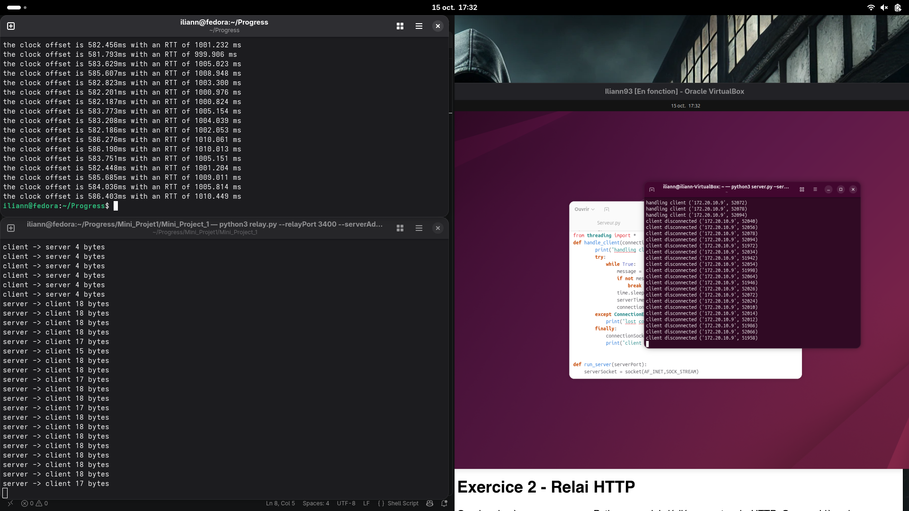


### Utilisation d'un LLM

**Modèle utilisé :** Claude Sonnet 5.5 (Anthropic).

**Usage :** comprendre la structure de l'exercice (pourquoi deux sens, un thread par client, fermeture avec `shutdown`), puis relire notre code et expliquer les erreurs. Le code du relais a été écrit par nous, et Claude l'a relu et critiqué.

| Prompt | Résultat (résumé) |
|---|---|
| "now we will move to mini project one" (avec le PDF du sujet) | explication des deux exercices, de l'approche et d'un ordre de travail, sans code |
| "so we need to do exercice one first basiclly we are a team of 2 so we cant one works one exercice one and the other on the second" | proposition de répartition du travail et de décisions communes à prendre avant de se séparer |
| "in exo one the relay has which ip address" | le relais n'a pas d'IP propre, il utilise celle de sa machine ; le client vise son IP et son port |
| "est ce que ce shema est juste" (avec notre schéma) | le flux est correct ; il manquait `bind`/`listen` côté relais, le `connect` vers le serveur, les ports, et les deux threads |
| "is connect blocking ?" | oui ; le `connect` vers le serveur se fait dans le thread du client, avec un timeout conseillé |
| "so we create the two sockets after we accept the connection to the client we make a thread that makes a connection to the server sends the server the data that came from the clinet waits for the answer send it back to the client closes everything so its one thread ?" | la mise en place est juste, mais un seul sens ne suffit pas : il faut deux boucles en même temps |
| "so the client thread creates another thread write ?" | oui : le thread du client en lance un deuxième pour un sens et fait l'autre sens lui-même |
| "if the server sends a 10kb file lets say and the relay recv 2048 each time and forward it to the user wont that be a mess like the order and all that and how the user can order all the responses" | TCP garantit l'ordre ; seules les frontières des morceaux changent |
| "wdyt about this other version my binom made it" | la version qui alterne client/serveur marche pour le serveur de l'heure mais pas pour une réponse de plus de 2048 octets ni si le serveur parle le premier |
| "why my teammate code is not good when its not client server order" | cas où l'alternance bloque : serveur qui parle d'abord, plusieurs messages, réponse en plusieurs morceaux |
| "what if we do it like my teammate and add aloop that recv until there is nothing to recv" | `recv` ne dit pas "plus rien pour l'instant" ; lire jusqu'à la fermeture ne marche pas si le serveur garde la connexion ouverte |

---

## Exercice 2 - Relais HTTP

### Pourquoi une approche séquentielle

Pour le HTTP, on ne garde pas les deux boucles de l'exercice 1. Le relais doit **comprendre** les messages : le cache a besoin de la réponse complète, le journal de son statut et de la taille du corps, la censure de la requête avant de contacter le serveur et du contenu de la page. Un relais qui recopie les octets au fil de l'eau n'a jamais le message en entier.

On traite donc une requête à la fois par client :

1. lire la requête complète, qui se termine à la ligne vide `\r\n\r\n` ;
2. décider (censure, cache) ;
3. si besoin, transmettre au serveur et lire la réponse complète ;
4. renvoyer la réponse au client, puis fermer.

Pour que cela marche, on force `Connection: close` dans la requête envoyée au serveur : le serveur ferme la connexion après sa réponse, donc la réponse se termine quand `recv` renvoie `b''`. On retire aussi l'en-tête `Accept-Encoding`, pour que les pages arrivent non compressées (on peut ainsi les lire et les modifier). Chaque requête ouvre une nouvelle connexion vers le serveur, ce qui est moins rapide que le keep-alive, mais beaucoup plus simple.

Comme il n'y a qu'un seul serveur derrière le relais, le navigateur parle au relais comme à un serveur : la ligne de requête ne contient que le chemin (`GET /index.html`). La clé du cache est ce chemin.

### Fonctionnement du relais HTTP

Pour chaque client (un thread par client) :

1. lecture de la requête (timeout de 10 s) et analyse : méthode, chemin, version, en-têtes ;
2. adresse du client = première valeur de `X-Forwarded-For` si elle existe, sinon l'adresse de la connexion ; ainsi, dans une chaîne de relais, on garde l'IP du vrai client ;
3. si `--log` et méthode GET : une ligne `REQUEST` est écrite dans le journal ;
4. si `--ban` et que le chemin contient un site interdit : réponse `403 Forbidden`, l'IP du client est écrite dans `forbidden.log`, et on s'arrête ;
5. si `--cache` : on regarde dans le cache (une réponse déjà vue est renvoyée sans contacter le serveur) ;
6. sinon on se connecte au serveur, on envoie la requête reconstruite, on lit la réponse jusqu'à la fermeture ; une réponse vide donne un `502` ;
7. si `--cache`, méthode GET et statut 200 : la réponse est mise dans le cache ;
8. si `--ban` : les liens `<a href="...">` qui contiennent un site interdit sont remplacés par `Forbidden` dans le corps de la page (et `Content-Length` est recalculé) ;
9. la réponse est envoyée au client ; si `--log` et que le corps n'est pas vide, une ligne `RESPONSE` est écrite **après** l'envoi.

Les erreurs côté client et côté serveur sont séparées : un client qui part ou qui reste silencieux est simplement fermé, un problème côté serveur renvoie `502` (serveur éteint, adresse invalide, connexion coupée, réponse mal formée) ou `504` (timeout).

### Cache

Un dictionnaire partagé entre tous les threads (chemin → réponse complète), protégé par un verrou, avec une fonction pour lire et une pour écrire. On ne met en cache que les réponses `200` à un `GET`. Les erreurs ne sont jamais mises en cache. Un client qui demande une page déjà vue par un autre client reçoit la copie locale, sans nouvelle requête au serveur. Pas d'expiration.

### Journal et audit

Le journal est un fichier texte, une ligne par événement, avec 7 colonnes séparées par des tabulations :

```
horodatage   id   type   IP client   uri   statut   taille du corps
```

- `type` vaut `REQUEST` (statut et taille vides) ou `RESPONSE` ;
- `id` est un identifiant unique par requête, le même sur la ligne `REQUEST` et sur la ligne `RESPONSE` ;
- la ligne `REQUEST` est écrite dès que la requête est lue, donc même si le serveur est éteint ; la ligne `RESPONSE` n'est écrite que si le corps n'est pas vide et que la réponse a été envoyée au client ;
- une réponse est « non vide » quand son corps fait plus de 0 octet, quel que soit le statut : une page d'erreur 404 a un corps, elle est donc journalisée avec son statut et comptée par l'audit ;
- les tabulations et retours à la ligne sont remplacés par des espaces dans les champs, pour ne pas casser le format ;
- les écritures sont protégées par un verrou, pour que les lignes de plusieurs threads ne se mélangent pas.

Exemple (colonnes séparées par des tabulations) :

```
2026-10-15T11:02:03.120   9f2c...   REQUEST    127.0.0.1   /index.html
2026-10-15T11:02:03.131   9f2c...   RESPONSE   127.0.0.1   /index.html   200   15
```

Le journal est écrit dans `relay.log`, dans le dossier d'où on lance le relais. C'est un choix assumé : si plusieurs relais journalisent depuis le même dossier, leurs lignes vont dans le même fichier. L'IP et l'identifiant permettent de s'y retrouver.

`audit.py` lit le journal ligne par ligne, garde les lignes `RESPONSE` dont l'URI contient le texte cherché et dont le corps n'est pas vide, et affiche les IP des clients (sans doublon, triées). Les lignes mal formées sont ignorées, et un fichier absent donne un message d'erreur.

### Censure

Les sites interdits sont dans un fichier texte (un par ligne ; les lignes vides et celles qui commencent par `#` sont ignorées). Si le fichier est absent ou illisible, le relais affiche une erreur et s'arrête avant de démarrer. Il y a deux comportements :

- si le chemin demandé contient un site interdit : le relais répond lui-même `403 Forbidden` et ne contacte pas le serveur ;
- si la page renvoyée contient un lien `<a href="...">` vers un site interdit : le lien est remplacé par `Forbidden` dans le corps de la réponse.

Dans les deux cas, l'IP du client est écrite dans `forbidden.log`. La censure est vérifiée avant le cache, donc une page interdite n'est jamais servie depuis le cache, et la censure du contenu s'applique aussi aux pages qui viennent du cache. La comparaison se fait sur le texte en minuscules, avec le chemin seulement (le nom du serveur est toujours le même derrière un relais).

### Comment lancer

Serveur de test (dans un dossier qui contient quelques fichiers) :

```
python -m http.server 8000
```

Relais :

```
python http_relay.py --relayPort 8001 --serverPort 8000                       # simple relais
python http_relay.py --relayPort 8001 --serverPort 8000 --cache               # avec cache
python http_relay.py --relayPort 8001 --serverPort 8000 --log                 # avec journal
python http_relay.py --relayPort 8001 --serverPort 8000 --ban banned.txt      # avec censure
python http_relay.py --relayPort 8001 --serverPort 8000 --cache --log --ban banned.txt
```

| Option | Défaut | Rôle |
|---|---|---|
| `--relayPort` | 3456 | port d'écoute du relais |
| `--serverAddress` | 127.0.0.1 | adresse du serveur, ou du relais suivant dans une chaîne |
| `--serverPort` | 8000 | port du serveur, ou du relais suivant |
| `--cache` | désactivé | active le cache |
| `--log` | désactivé | active le journal (`relay.log`) |
| `--ban` | aucun | fichier des sites interdits |

Exemple de fichier `banned.txt` :

```
# sites interdits
google.com
```

Client : un navigateur ou `curl` sur le port du relais :

```
curl -i http://127.0.0.1:8001/index.html
```

Chaînage : le « serveur » d'un relais peut être un autre relais. Par exemple client → cache → journal → serveur :

```
python http_relay.py --relayPort 8002 --serverPort 8000 --log
python http_relay.py --relayPort 8001 --serverPort 8002 --cache
```

Audit :

```
python audit.py --file relay.log --uri index.html
```

Dans une chaîne, l'ordre change ce que voit chaque relais : un journal placé derrière un cache ne voit pas les requêtes servies par le cache.

### Tests réalisés

Les tests ont été faits avec le relais sur la machine hôte et un petit serveur web en Python lancé dans une machine virtuelle (adresse 172.20.10.10, port 9300). Le navigateur demande aussi `/favicon.ico` à chaque page, ce qui explique les lignes en plus dans les terminaux et dans les journaux.

**Capture 1 : cache, premier accès (cache miss).** Le relais (port 3400, option `--cache`) transmet vers le serveur de la machine virtuelle. Le navigateur demande `/test.txt` : le relais affiche `cache miss` puis se connecte au serveur. À droite, le serveur reçoit la requête avec `Connection: close` et l'en-tête `x-forwarded-for: 127.0.0.1` ajouté par le relais, et répond `200` avec `Content-length: 17`.

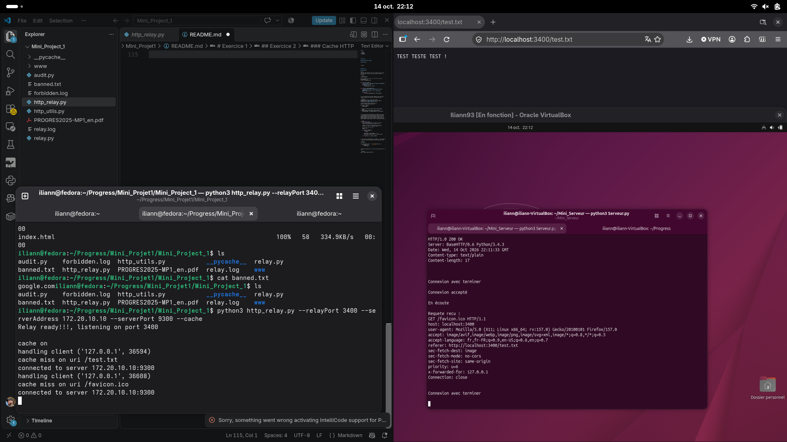

**Capture 2 : cache, deuxième accès (cache hit).** Le même `/test.txt` est demandé dans un nouvel onglet. Le relais affiche `cache hit` et ne se connecte pas au serveur : côté serveur, aucune nouvelle requête n'apparaît.

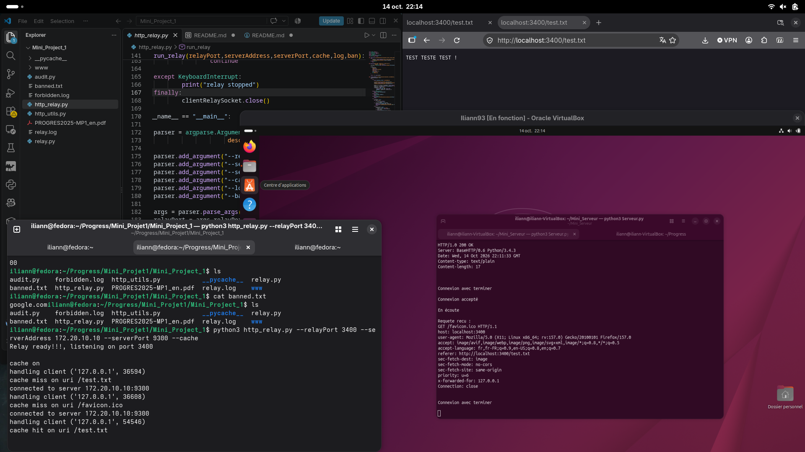

**Capture 3 : fichier binaire.** Le navigateur demande `/image/Internet.jpg` (722 614 octets, `Content-type: image/jpeg`). Le relais la transmet en entier et l'image s'affiche normalement, donc aucun octet n'est perdu. C'est aussi un `cache miss` : l'image est ensuite gardée dans le cache.

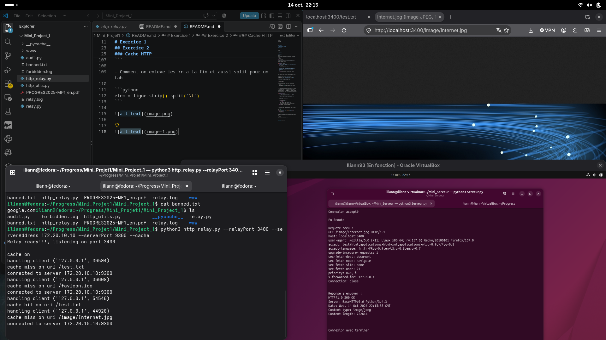

**Capture 4 : le journal `relay.log`.** Relais lancé avec `--log`. Chaque requête donne une ligne `REQUEST` et une ligne `RESPONSE` avec le même identifiant, puis l'IP du client, l'URI, le statut et la taille du corps (par exemple `/test.txt` 200 17 octets, `/image/Internet.jpg` 200 722614 octets). Une page absente (404) est aussi journalisée avec son statut.

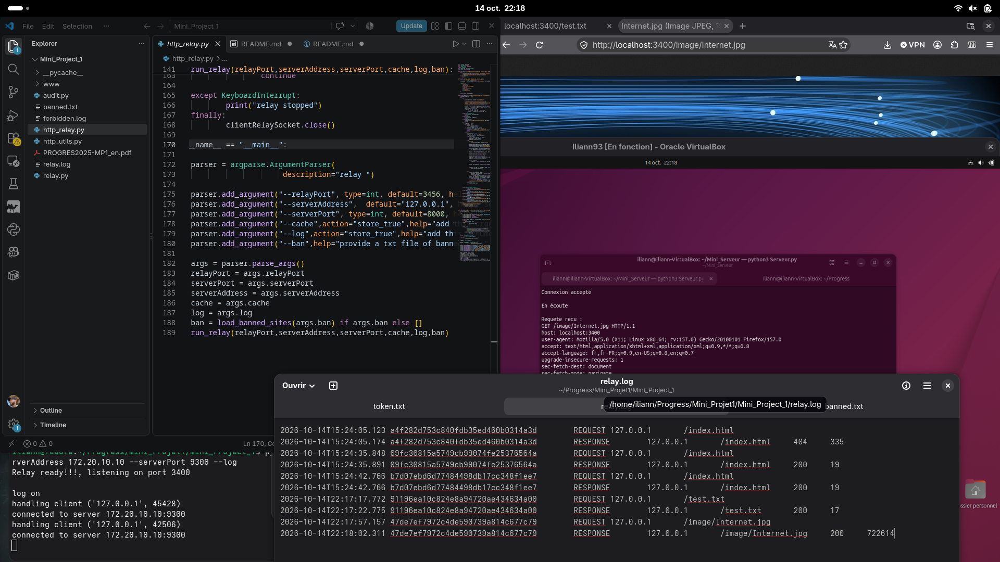

**Capture 5 : la censure.** Le fichier `banned.txt` contient `google.com`, et la page `index.html` contient un lien `<a href="google.com">banned section</a>`. Avec `--ban banned.txt`, le navigateur affiche `hello` puis `Forbidden` à la place du lien. Les guillemets affichés viennent du fichier de test lui-même. On voit aussi, dans le terminal, l'erreur d'`argparse` quand `--ban` est donné sans fichier.

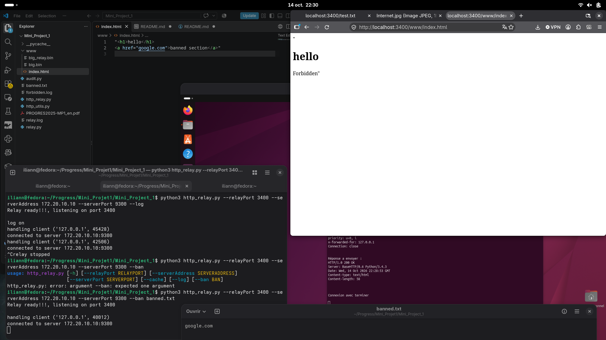

**Capture 6 : chaînage client → cache → journal → serveur.** Le relais du haut (port 3401, `--cache`) transmet au relais du bas (port 3400, `--log`), qui transmet au serveur. Après deux `cache miss` (`/test.txt` et `/favicon.ico`), le deuxième accès à `/test.txt` donne un `cache hit` : le relais du bas ne reçoit rien de nouveau. Un relais placé derrière un cache ne voit donc pas les requêtes servies par le cache.

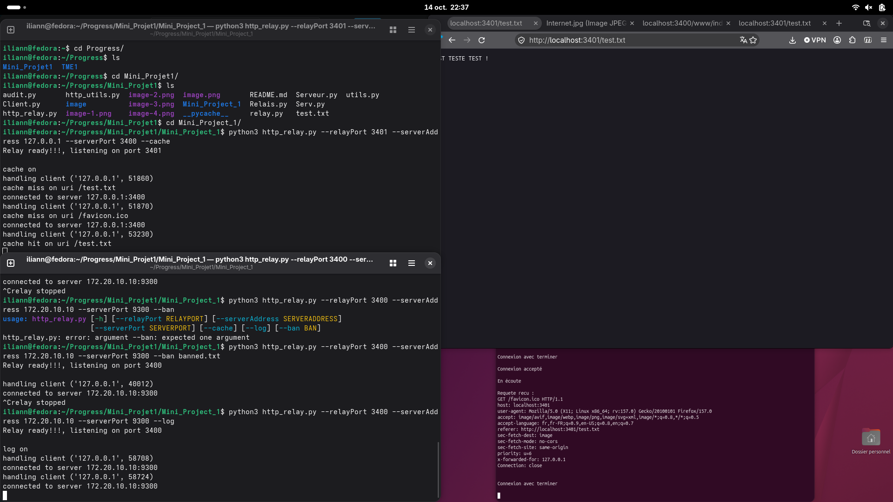

**Capture 7 : requêtes simultanées dans le journal.** La requête de `/image/Internet.jpg` (22:38:23) et celle de `/www/index.html` (22:38:26) sont écrites avant leurs réponses, et les lignes sont mélangées. L'identifiant permet d'associer chaque `RESPONSE` à sa `REQUEST`. On voit aussi deux réponses 404 (`/favicon.ico` et `/www/google.com`).

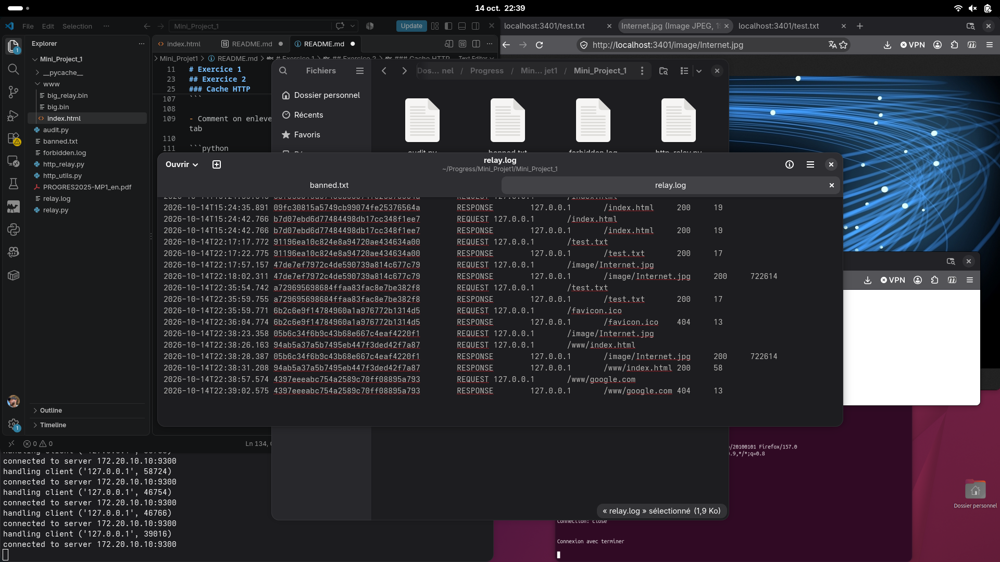

**Capture 8 : deux relais derrière le même relais.** Deux relais d'entrée (ports 3401 et 3402, `--log`) pointent vers le même relais de censure (port 3400, `--ban banned.txt`), qui est relié au serveur. Les deux pages `index.html` affichent `Forbidden` à la place du lien.

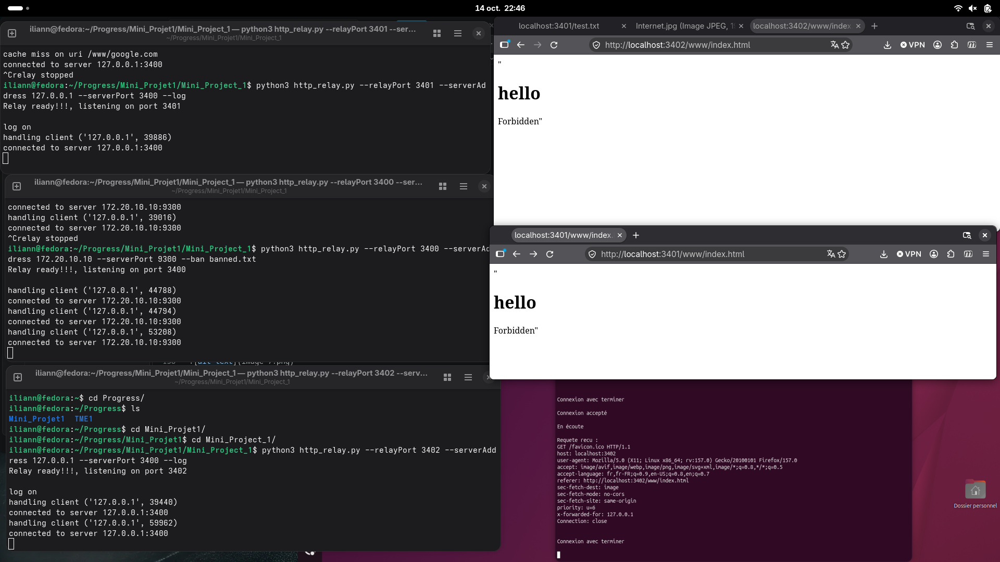

**Capture 9 : récupération des IP dans le fichier log.** Nous lançons le programme `audit.py` en lui indiquant le fichier de traces à analyser (`--file relay.log`) ainsi que l’URI de l’image `Internet.jpg` (`--uri /image/Internet.jpg`). L’adresse IP récupérée est `127.0.0.1`, ce qui correspond bien à l’adresse indiquée dans le fichier de traces.

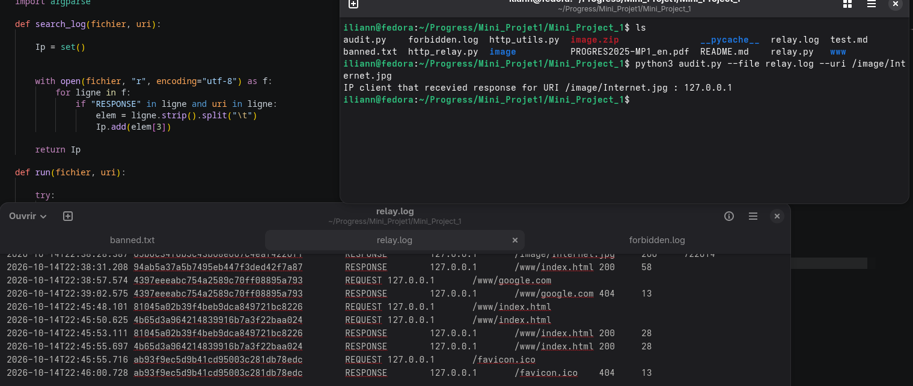


### Limites

- Seul `GET` est traité (cache, journal, censure). Le corps d'une requête `POST` n'est pas transmis.
- Pas de keep-alive : une connexion au serveur par requête.
- Les réponses sont entièrement gardées en mémoire, et le cache n'a pas d'expiration.
- La censure du contenu ne remplace que les liens `<a href="...">` avec des guillemets.
- `X-Forwarded-For` est pris tel quel : un client peut y mettre une fausse adresse.

### Utilisation d'un LLM

Deux modèles ont été utilisés pour cet exercice, chacun de nous en a utilisé un.

**Claude Sonnet 5.5 (Anthropic) :**

1. comprendre la structure de l'exercice et décider de l'approche (séquentiel, `Connection: close`, cache/journal/censure activés par options, chaînage) ;
2. relire notre code (relais, fonctions utilitaires, gestion des erreurs, journal, censure) et expliquer les erreurs rencontrées ;
3. corriger `audit.py` : on lui a demandé de garder notre code et de corriger les erreurs, et la version corrigée (lecture par colonnes, lignes mal formées ignorées, corps non vide) a été écrite par Claude ;
4. écrire ce README.

**Gemini 1.5 :** créations d'un verrou (`log_lock = Lock()`) ainsi que les fonctions `cache_put` et `cache_read` permettant respectivement d’écrire dans le dictionnaire du cache et d’y lire des données. L’utilisation du verrou garantit la synchronisation des accès au cache lorsque plusieurs threads y accèdent simultanément.

**Chat-GPT 6 :** écrire les fonctions utilitaires de `http_utils.py` (`parse_request`, `split_response`), et expliquer comment lire un fichier ligne par ligne avec un ensemble d'adresses, découper une ligne sur les tabulations et créer le dossier du journal avec `Path` (utilisé dans `write_log` et `audit.py`). Le code obtenu pour le cache, `parse_request` et `split_response` a été repris dans `http_utils.py`.

Le reste du code a été écrit par nous, et Claude l'a relu et critiqué.

**Prompts envoyés à Claude :**

| Prompt | Résultat (résumé) |
|---|---|
| "write me detailed task split to send to my teammate" | liste de décisions communes, interface des fonctions de `http_utils.py`, répartition des tâches, tests et plan du rapport |
| "why its better to do sequential in the second exercice ?" | le cache, le journal et la censure ont besoin du message complet, et HTTP est requête puis réponse |
| "can it work with non sequential ?" | oui, mais il faut relire la requête en entier avant de décider et partager l'état entre threads ; plus de code pour le même résultat |
| "the cashe should be a function or what ?" | un dictionnaire et un verrou au niveau du module, avec deux fonctions (lire, écrire) |
| "why the lock ?" | les threads partagent le dictionnaire ; le verrou est surtout indispensable pour le fichier journal |
| "why we need build request when er already have the read req ?" | il faut changer des en-têtes avant de transmettre (`Connection: close`, pas de `Accept-Encoding`, `X-Forwarded-For`) |
| "are `read_response`, `build_response` diffrent from  `read_request`, `build_request` ?" | `read_request` s'arrête à la ligne vide, `read_response` à la fermeture ; `build_request` modifie, `build_response` crée avec `Content-Length` |
| "why we use split_reponse" | pour lire le statut (cache, journal) et la taille du corps (audit) ; on envoie toujours les octets d'origine |
| "the relai connects to only one server" | avec un seul serveur, le chemin suffit comme clé de cache ; la censure se compare au chemin |
| "how can u split the error that i send for client and server disconnections" | séparer le code en phases (lecture client, serveur, envoi au client), avec 502/504 seulement pour les erreurs du serveur |
| "when i add an outer try except will it run the finnaly after returning ?" | oui, `finally` s'exécute aussi après un `return` |
| "do i make the cache optional in the main so when u run the relay u can chose with cache or no or i keep it always with cache ?" | option `--cache` désactivée par défaut, pour pouvoir chaîner des relais différents |
| "For the log functionality do I put it kn the util or relay" | écriture (verrou) dans `http_utils.py`, construction de la ligne et appel dans le relais |
| "how can i identify the req and res using id how do i track the id" | l'identifiant est une variable locale du thread, créée une fois et écrite sur les deux lignes (uuid) |
| "how to close the program if we fail to open the ban file" | `sys.exit(1)` au démarrage, avant d'ouvrir les sockets |
| "i finished all the code ill give it to you and give me an overall review for it" | revue complète : ordre d'écriture du journal, audit par colonnes, nettoyage des champs, limites à écrire dans le rapport |
| "fix the audit function" puis "keep the old code just fix the mistakes" | version corrigée de `audit.py` qui garde notre structure |
| "take it and make the finnal readme just like for tme1 in french ..." puis "fix the readme" | ce README |

**Prompts envoyés à Chat-GPT :**

| Prompt | Résultat (résumé) |
|---|---|
| "bon j'aimerai faire moi meme, comment on parcour genre chaine de caractere du coup les byt ligne par ligne" | découpage d'un message en octets ligne par ligne avec `splitlines()` |
| "fais und fonction parse_request qui prend juste le truc la la requete etu tu renvoie du coup 4 valeur, le premier la method genre juste le get ensuite le fichier donc le chemin, ensuite la version, et ensuite tu fai un sort de dictionnaire avec les en ttes HTTP de la requete, avec le nom de chaque en tete comme clef et sa valeur comme valeur . Jtes dit c pour le cache et les autre" | `parse_request` : méthode, chemin, version et dictionnaire des en-têtes |
| "mtn split_response qui prend la reponse et qui split en statu les entete et tu met la reponse genre le corps" | `split_response` : statut, en-têtes et corps |
| "uste montre moi comment faire un esemble, , ensuite quand on fais un with open, comment on parcour ligne par ligne" | création d'un `set` et lecture d'un fichier ligne par ligne avec `with open` |
| "Comment on enleve les \n a la fin et aussi split pour un tab" | `ligne.strip().split("\t")` |
| "Fais avec path genre on verifie au debut si le chemin ya un dossier au debut bah quil existe et si il existe pa son le crée" | `Path(fichier).parent.mkdir(parents=True, exist_ok=True)` |


**Prompts envoyés Gemini :**

| Prompt | Résultat (résumé) |
|---|---|
| "ais moi deux fonction, une qui lis dans le dico, et une qui ecrit dans le dico, avec un verrou pour lecture et ecriture" | deux fonctions protégées par un `Lock` (devenues `cache_put` et `cache_read`) |